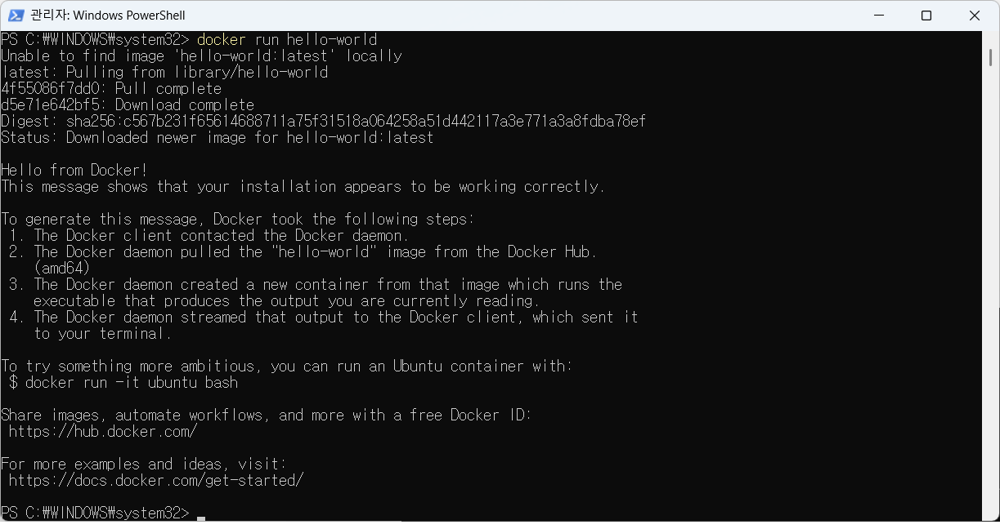
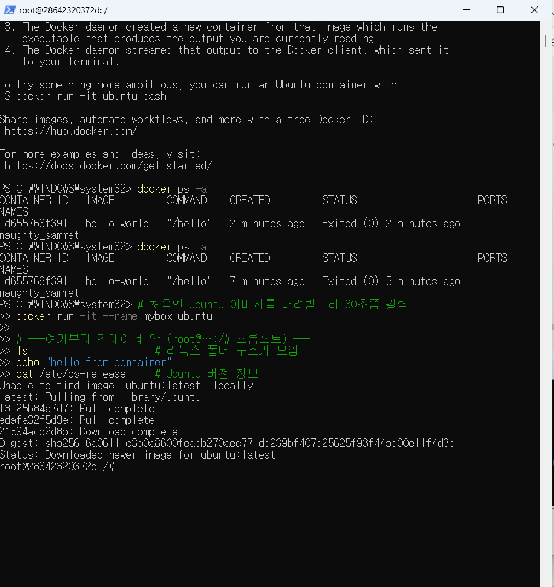
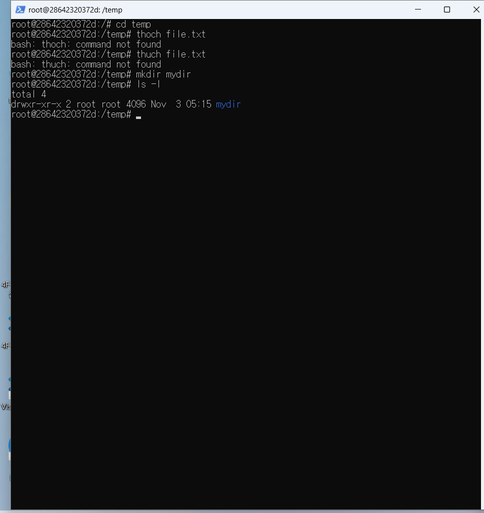
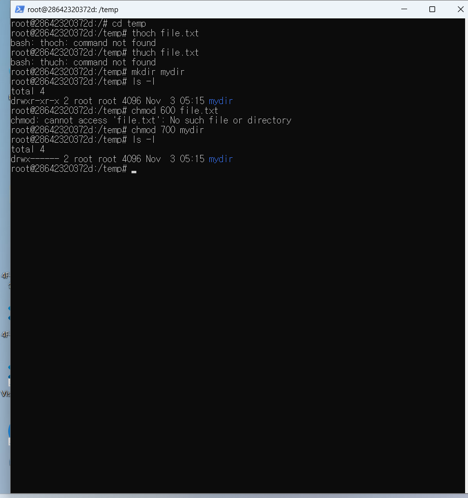
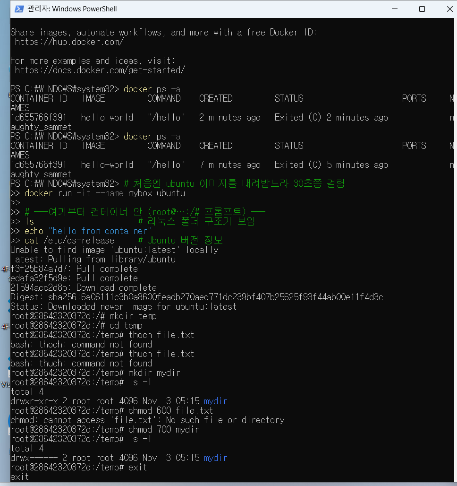
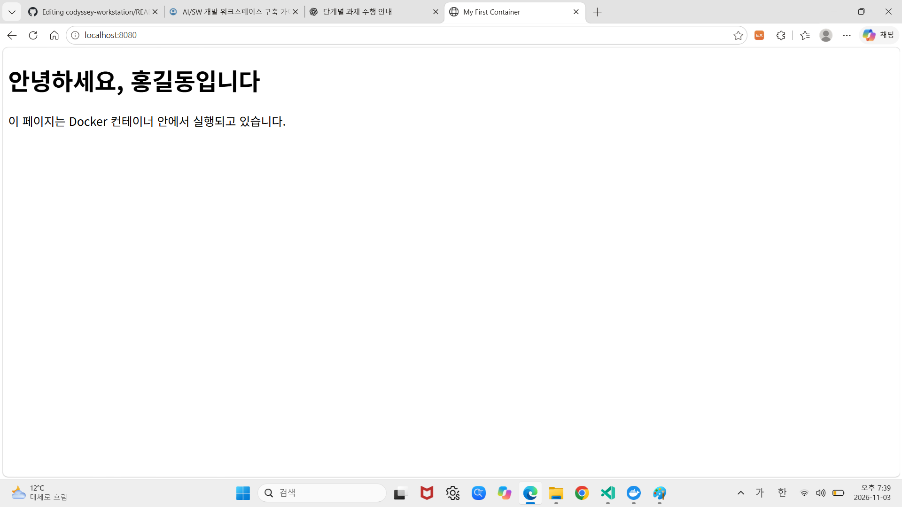
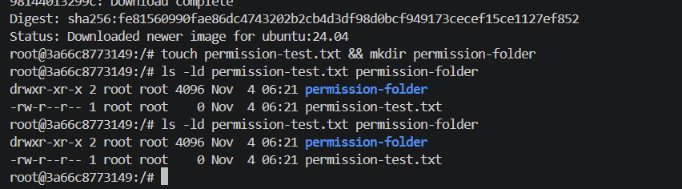
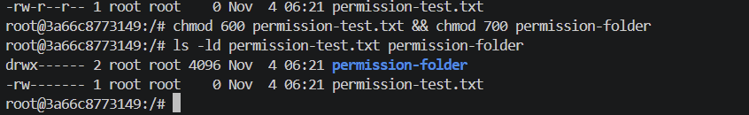
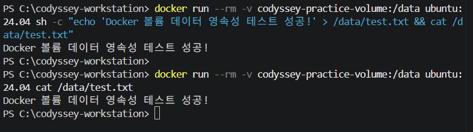

# 내 컴퓨터에 개발자용 작업실 꾸미기

## 1. 프로젝트 소개

Windows 11 환경에서 개발자용 작업 환경을 구성하고 터미널, Git, Docker의 기본 사용법을 실습한 프로젝트입니다.

실습 과정과 실행 결과, 오류 해결 방법을 기록하여 다른 사람도 따라 할 수 있도록 정리했습니다.

## 2. 개발 환경

- 운영체제: Windows 11
- 터미널: PowerShell
- 컨테이너 환경: Docker Desktop
- Linux 이미지: Ubuntu 24.04
- 웹 서버 이미지: Nginx
- 버전 관리: Git
- 저장소: https://github.com/ttoli54/codyssey-workstation

## 3. 실습 내용

### 3-1. Git 환경 구성

- Git 설치 및 버전 확인
- Git 사용자 이름과 이메일 설정
- 프로젝트 폴더에서 Git 저장소 초기화
- GitHub 원격 저장소 연결

### 3-2. Docker 기본 실습

- Docker Desktop 설치 및 실행
- `docker info`로 Docker 환경 확인
- `docker run hello-world`로 컨테이너 실행 확인
- Ubuntu 24.04 컨테이너 실행
- 컨테이너 내부에서 `pwd`, `whoami`, `ls`, `ls -la` 명령어 실습

### 3-3. Linux 파일 권한 실습

Ubuntu 컨테이너에서 파일과 폴더를 생성하고 권한을 변경했습니다.

```bash
chmod 600 permission-test.txt
chmod 700 permission-folder
```

- 변경 전 파일 권한: `-rw-r--r--`
- 변경 후 파일 권한: `-rw-------`
- 변경 전 폴더 권한: `drwxr-xr-x`
- 변경 후 폴더 권한: `drwx------`

### 3-4. Docker 이미지와 컨테이너

Dockerfile을 작성하여 Nginx 기반 웹 서버 이미지를 생성했습니다.

```dockerfile
FROM nginx
COPY index.html /usr/share/nginx/html/index.html
```

이미지 빌드 명령어:

```bash
docker build -t my-web .
```

컨테이너 실행 및 포트 연결:

```bash
docker run -d -p 8080:80 --name my-web my-web
```

브라우저에서 `http://localhost:8080`에 접속하여 웹 페이지가 표시되는 것을 확인했습니다.

### 3-5. 포트 매핑 실습

추가 컨테이너를 실행하고 포트 매핑을 확인했습니다.

- 호스트 포트 8081 → 컨테이너 포트 80
- 접속 주소: `http://localhost:8081`

### 3-6. 바인드 마운트 실습

내 컴퓨터의 폴더를 컨테이너 내부 웹 서버 폴더에 연결했습니다.

- 호스트 폴더: `bind-mount-practice`
- 컨테이너 경로: `/usr/share/nginx/html`
- 호스트 파일을 수정한 뒤 브라우저에서 변경 내용이 반영되는 것을 확인했습니다.

### 3-7. Docker 볼륨 실습

Docker 볼륨을 생성하고 데이터를 저장한 후 다른 컨테이너에서 동일한 데이터를 읽어 영속성을 확인했습니다.

- 볼륨 이름: `codyssey-practice-volume`
- 저장 파일: `/data/test.txt`

## 4. 오류 해결 기록

### 오류 1. Docker 엔진 연결 오류

- 원인: Docker Desktop 엔진이 준비되기 전에 명령어를 실행했습니다.
- 해결: Docker Desktop을 실행하고 엔진이 정상적으로 시작된 후 다시 확인했습니다.

### 오류 2. Git 명령어 인식 오류

- 원인: Git 설치 경로가 PowerShell PATH에 등록되지 않았습니다.
- 해결: Git 실행 경로를 현재 PowerShell PATH에 추가하여 Git 명령어가 실행되도록 했습니다.

## 5. 프로젝트 파일 구성

```text
codyssey-workstation/
├── bind-mount-practice/
│   └── index.html
├── app/
│   ├── index.html
│   └── permissions-test.txt
├── evidence/                 # 실제 터미널 실행 로그와 볼륨 백업
├── scripts/
│   └── collect-evidence.ps1  # 검증 명령 실행 및 로그 저장
├── 1.png
├── 2.png
├── 3.png
├── 4.png
├── 5.png
├── 6.png
├── 07-permission-before.png
├── 08-permission-after.png
├── Dockerfile
├── index.html
└── README.md
```

각 항목의 목적은 다음과 같습니다.

| 경로 | 목적 |
| --- | --- |
| `app/` | 웹 콘텐츠와 권한 실습용 파일 |
| `bind-mount-practice/` | 호스트 변경이 컨테이너에 반영되는지 확인하는 정적 파일 |
| `Dockerfile` | Nginx 기반 커스텀 이미지 정의 |
| `scripts/collect-evidence.ps1` | Windows PowerShell에서 실습 명령을 재실행하고 출력 저장 |
| `evidence/` | 평가자가 확인할 실제 명령·출력 로그와 볼륨 백업 |
| `*.png` | 실행 화면 캡처 |
| `README.md` | 재현 절차, 개념, 결과 및 트러블슈팅 문서 |

## 6. 실습 결과 및 증빙 자료

아래는 개발 환경 구성과 Docker 실습 과정에서 촬영한 증빙 이미지입니다.

### 6-1. 기본 개발 환경 및 Docker 실습













### 6-2. Linux 파일 권한 변경 실습

**권한 변경 전**



**권한 변경 후**



### 6-3. Docker 볼륨 데이터 영속성 실습



## 7. 마무리

이번 프로젝트를 통해 Windows 환경에서 개발 작업 공간을 구성하고 Git, Docker, Linux 명령어의 기본 사용법을 실습했습니다.

또한 Docker 이미지 생성, 컨테이너 실행, 포트 매핑, 바인드 마운트, 볼륨을 직접 경험하며 컨테이너 환경의 기본 개념을 익혔습니다.

## 8. 사전평가 보완: 실행 증거

README의 설명만으로 성공을 주장하지 않고, 아래 스크립트가 실제로 실행한 명령과 출력을 `evidence/`에 저장합니다.

### 8-1. 전체 재현 절차

PowerShell에서 저장소 루트로 이동한 뒤 실행합니다.

```powershell
Set-Location "C:\path\to\codyssey-workstation"
Set-ExecutionPolicy -Scope Process Bypass
.\scripts\collect-evidence.ps1
Get-ChildItem .\evidence
```

스크립트는 Docker 버전·엔진 상태, Git 사용자·기본 브랜치·원격·커밋, 파일 조작, Linux 권한 변경, `hello-world`, Ubuntu `exec`, 이미지 빌드, 8080 포트 접속, `ps/images/logs/stats`, 바인드 마운트 변경 반영, 볼륨 삭제 후 데이터 유지, 볼륨 백업을 순서대로 실행합니다. 각 명령의 전체 출력은 [evidence/README.md](./evidence/README.md)에 정리되어 있습니다. 테스트 컨테이너와 볼륨은 실행마다 고유한 이름을 사용하며, 실패해도 `finally` 정리 단계가 실행됩니다.

### 8-2. 실행 증거 목록

| 평가 항목 | 증거 |
| --- | --- |
| Docker 버전·엔진 | [01-environment.txt](./evidence/01-environment.txt), [02-docker-info.txt](./evidence/02-docker-info.txt) |
| Git 원격·커밋 | [03-git-environment.txt](./evidence/03-git-environment.txt) |
| 권한 변경 전·후 | [04-permissions.txt](./evidence/04-permissions.txt) |
| `hello-world` | [05-hello-world.txt](./evidence/05-hello-world.txt) |
| Ubuntu 컨테이너와 `exec` | [06-ubuntu-container.txt](./evidence/06-ubuntu-container.txt), [07-ubuntu-exec.txt](./evidence/07-ubuntu-exec.txt) |
| 이미지 빌드 | [08-build.txt](./evidence/08-build.txt) |
| 포트 매핑·HTTP 접속 | [09-run-web.txt](./evidence/09-run-web.txt), [10-curl-web.txt](./evidence/10-curl-web.txt) |
| 이미지·컨테이너 운영 | [11-docker-operations.txt](./evidence/11-docker-operations.txt) |
| 바인드 마운트 반영 | [12-bind-mount.txt](./evidence/12-bind-mount.txt), [13-bind-before.txt](./evidence/13-bind-before.txt), [14-bind-after.txt](./evidence/14-bind-after.txt) |
| 볼륨 영속성 | [15-volume-create.txt](./evidence/15-volume-create.txt), [17-volume-before-delete.txt](./evidence/17-volume-before-delete.txt), [18-volume-after-delete.txt](./evidence/18-volume-after-delete.txt), [19-volume-inspect.txt](./evidence/19-volume-inspect.txt) |
| 볼륨 백업 생성·목록 | [20-volume-backup.txt](./evidence/20-volume-backup.txt), [21-volume-backup-list.txt](./evidence/21-volume-backup-list.txt) |
| 터미널 파일 조작 | [22-terminal-operations.txt](./evidence/22-terminal-operations.txt) |
| 수집 완료 여부 | [23-collection-status.txt](./evidence/23-collection-status.txt) |

`evidence/`의 로그는 실행 시점에 생성되므로 이미지 ID, 컨테이너 ID, 시간, 파일 크기는 실행 환경에 따라 달라집니다. 평가 제출 전 로그와 캡처에 토큰·비밀번호·개인키가 없는지 확인합니다.

### 8-3. GitHub·VSCode 연동 증거

CLI에서 확인 가능한 Git 사용자 설정·기본 브랜치·원격 저장소·최근 커밋은 [03-git-environment.txt](./evidence/03-git-environment.txt)에 기록하며 이메일은 `redacted`로 마스킹합니다. 현재 수집 환경에서는 Git 사용자 이름이 설정되지 않아 `user.name: missing`으로 기록되었습니다. 제출 전 아래 명령으로 본인의 값을 설정하고 로그를 다시 생성해야 합니다.

```powershell
git config --local user.name "본인 이름"
git config --local user.email "본인 이메일"
git config --local init.defaultBranch main
```

VSCode의 GitHub 로그인은 GUI 상태이므로 CLI 로그로 대신하지 않습니다. 제출 전 VSCode Source Control 패널에서 이 저장소가 열려 있고 동기화 대상이 `origin/main`임을 보여주는 캡처를 추가합니다. 기존 실행 캡처는 [1.png](./1.png)부터 [6.png](./6.png)까지 확인할 수 있으며, [6.png](./6.png)는 `localhost:8080` 브라우저 접속 증거입니다.

제출 전 체크리스트:

- [ ] Git 사용자 이름·이메일 설정 후 재수집한 로그
- [x] 기본 브랜치·원격·최근 커밋 로그
- [x] 터미널 파일 생성·복사·이동·이름 변경·삭제·내용 확인 로그
- [x] Docker 및 웹 서버 실행 로그
- [ ] VSCode GitHub 로그인/Source Control 연동 캡처(계정·이메일은 마스킹)

## 9. 핵심 개념 정리

### 9-1. 이미지와 컨테이너

| 구분 | 이미지 | 컨테이너 |
| --- | --- | --- |
| 생성 | `docker build`로 Dockerfile을 읽어 생성 | `docker run`으로 이미지에서 생성·실행 |
| 역할 | 실행에 필요한 파일시스템과 설정의 불변 템플릿 | 이미지가 실제로 실행되는 격리된 프로세스 |
| 변경 | Dockerfile을 수정하고 새 이미지로 다시 빌드 | 실행 중 파일 변경은 해당 컨테이너의 쓰기 계층에만 반영 |
| 확인 | `docker images` | `docker ps`, `docker ps -a`, `docker logs` |

컨테이너를 삭제하면 컨테이너 쓰기 계층의 변경은 사라질 수 있습니다. 보존해야 하는 데이터는 볼륨이나 바인드 마운트에 저장합니다.

### 9-2. 네트워크 네임스페이스와 포트포워딩

컨테이너는 기본적으로 별도의 네트워크 네임스페이스를 사용하므로 컨테이너의 `80` 포트가 호스트의 `80` 포트와 자동으로 같아지지 않습니다. `-p 8080:80`은 호스트의 `8080`으로 들어온 요청을 컨테이너의 `80`으로 전달하는 포트포워딩입니다. 따라서 브라우저는 `http://localhost:8080`으로 접속합니다.

### 9-3. 절대 경로와 상대 경로

절대 경로는 드라이브와 루트부터 시작해 위치가 명확하지만 컴퓨터마다 달라질 수 있습니다. 상대 경로는 현재 저장소를 기준으로 하므로 프로젝트를 다른 위치로 복사해도 재현하기 쉽습니다. 이 저장소의 명령은 `$PSScriptRoot`에서 저장소 루트를 계산해 바인드 마운트에 사용하므로 개인 PC의 절대 경로를 문서에 하드코딩하지 않습니다.

### 9-4. 숫자 권한과 `rwx`

권한 숫자는 소유자·그룹·기타 사용자 순서이며 `r=4`, `w=2`, `x=1`을 더합니다.

| 숫자 | `rwx` 표현 | 의미 |
| --- | --- | --- |
| `600` | `rw-------` | 소유자만 읽기·쓰기 |
| `700` | `rwx------` | 소유자만 읽기·쓰기·실행 |
| `644` | `rw-r--r--` | 소유자는 읽기·쓰기, 나머지는 읽기 |
| `755` | `rwxr-xr-x` | 소유자는 전체, 나머지는 읽기·실행 |

실제 변경 전·후 `ls -ld`와 숫자 모드는 [04-permissions.txt](./evidence/04-permissions.txt)에서 확인합니다.

### 9-5. 바인드 마운트와 볼륨 백업

바인드 마운트는 호스트의 특정 폴더를 컨테이너에 연결하므로 개발 중 파일 변경을 즉시 반영할 때 적합합니다. Docker 볼륨은 Docker가 관리하는 저장 영역이므로 애플리케이션 데이터 영속성에 적합합니다. 볼륨은 다음처럼 tar 백업으로 복구 가능한 사본을 만들 수 있습니다.

```powershell
docker run --rm `
  -v codyssey-practice-volume:/volume `
  -v "${PWD}\evidence:/backup" `
  alpine:3.20 tar czf /backup/codyssey-practice-volume-backup.tar.gz -C /volume .
```

### 9-6. Git과 GitHub

Git은 로컬에서 커밋과 버전을 관리하는 도구이고, GitHub는 Git 저장소를 원격에 보관하고 협업·제출하는 플랫폼입니다. `git remote -v`는 연결된 원격을 확인하고, `git log --oneline`은 로컬 커밋 이력을 확인합니다.

## 10. 포트 충돌 진단

### Windows PowerShell

```powershell
Get-NetTCPConnection -LocalPort 8080 -ErrorAction SilentlyContinue
netstat -ano | Select-String ":8080"
docker ps --format "table {{.ID}}\t{{.Names}}\t{{.Ports}}"
```

PID가 확인되면 `Get-Process -Id <PID>`로 프로세스를 식별합니다. Docker 컨테이너가 점유한 경우에는 이름을 확인한 후 해당 실습 컨테이너만 중지·삭제합니다.

```powershell
docker stop <container_name>
docker rm <container_name>
docker run -d -p 8080:80 --name my-web my-web:1.0
```

Linux 환경에서는 다음 명령으로 같은 문제를 확인할 수 있습니다.

```bash
ss -ltnp | grep ':8080'
lsof -nP -iTCP:8080 -sTCP:LISTEN
```

### 오류 해결 흐름

1. 가설: 다른 프로세스 또는 기존 컨테이너가 8080을 사용한다.
2. 확인: `Get-NetTCPConnection`, `netstat`, `docker ps`의 출력에서 PID와 포트 매핑을 확인한다.
3. 조치: 확인된 실습 컨테이너만 중지·삭제하거나 `-p 8081:80`으로 다른 호스트 포트를 사용한다.
4. 결과: `curl.exe -i http://localhost:8080` 또는 `http://localhost:8081` 응답을 로그로 남긴다.

## 11. 트러블슈팅 기록

### 오류 1. Docker 엔진 연결 오류

- 가설: Docker Desktop 엔진이 아직 시작되지 않았거나 현재 Docker context가 실행 엔진을 가리키지 않는다.
- 확인: `docker --version`은 클라이언트 확인이고, `docker info`의 `Server` 섹션이 데몬 확인이다. 실패한 출력도 숨기지 않고 [02-docker-info.txt](./evidence/02-docker-info.txt)에 남긴다.
- 조치: Docker Desktop 또는 OrbStack을 실행하고 `docker context show`를 확인한 뒤 `docker info`를 다시 실행한다.
- 결과: `docker info`에 `Server`, `Containers`, `Images`가 출력되면 엔진 확인이 완료된다.

### 오류 2. Git 명령어 인식 오류

- 가설: Git 실행 파일이 PowerShell `PATH`에 없다.
- 확인: `git --version`과 `$env:Path -split ';'`를 실행하고, Git 설치 경로가 포함되는지 확인한다.
- 조치: Git을 재설치하거나 현재 세션에 설치 경로를 추가한 뒤 새 PowerShell을 연다.
- 결과: `git --version`, `git remote -v`, `git log --oneline -1` 출력이 [03-git-environment.txt](./evidence/03-git-environment.txt)에 남는다.

### 오류 3. 포트 충돌

- 가설: 8080 포트가 기존 프로세스나 컨테이너에 의해 사용 중이다.
- 확인: [10-curl-web.txt](./evidence/10-curl-web.txt)와 포트 진단 명령의 PID·컨테이너 매핑을 비교한다.
- 조치: 해당 실습 컨테이너만 정리하거나 호스트 포트를 8081로 변경한다.
- 결과: 변경한 포트의 curl 응답과 `docker ps -a` 결과를 함께 보관한다.
